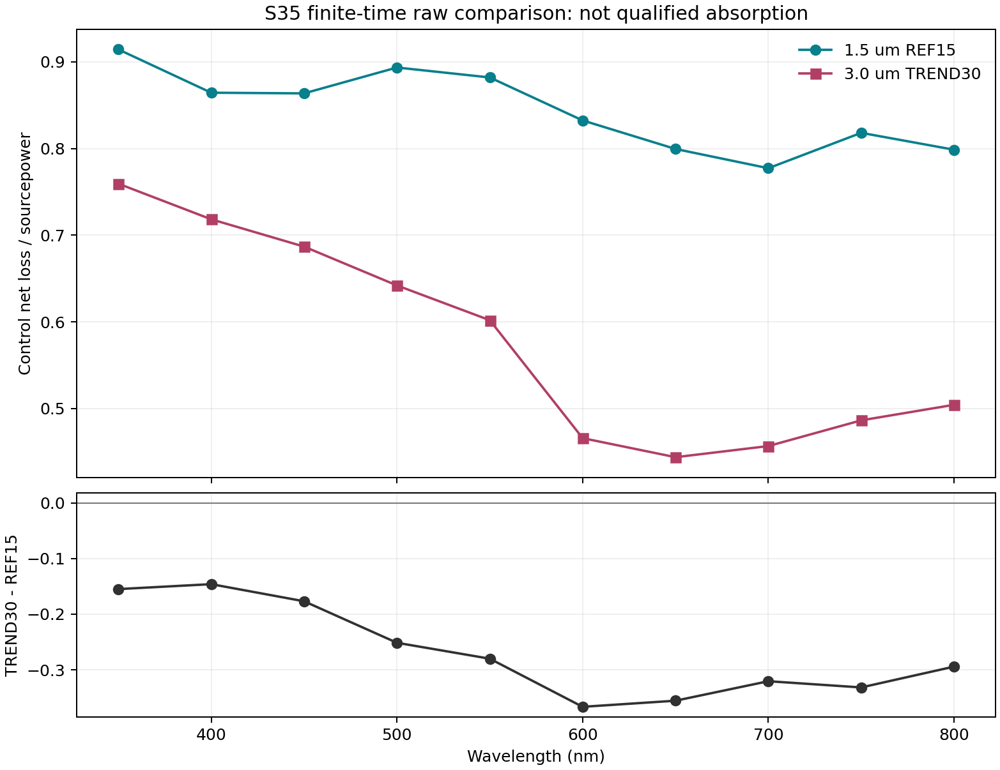

# 当前工作、结果与仿真状态

报告编号：OPT-SIZE-STATUS-AND-FAST-VALIDATION-HANDOFF-20261013-01 / v01。日期：2026-10-13。

## 1. 给用户和 Pro 的结论

目前不是“已启动了新的快速轻量模型”。实际工作已经偏向四个长时细网格算例，以及 REF120 的材料/监视器/记录域证据审查。这与用户要求先快速验证趋势的目的存在偏差，应明确纠正。

现在已有两尺寸旧 S35、约 2900 fs 的 R/T/总控制域通量趋势，可以用于讨论候选方向。四个 5800 fs 长例在最后一次核验时仍未结束；REF120 开发算例已结束，保存结果经过只读快照、导出、解码和独立核验。最近成功退出的 producer/verifier 是离线分析进程，不是新的 FDTD 求解。

用户要求本次先停止轮询、整理并上传。自动轮询 s35 已暂停；已有求解、输入、runner 和 task 未修改或中断。没有追加、加倍、重启或重放任何长例，也没有启动快速试算。后续执行等待用户讨论后的明确指令，不自动恢复轮询。

## 2. 原模型与实际执行路线

| 项目 | P15 / REF15 | P30 / TREND30 |
|---|---|---|
| 柱边长 | 1.5 µm | 3 µm |
| 柱高 | 9 µm | 9 µm |
| 原周期区域 | 9 × 5.1961524227 µm | 18 × 10.3923048454 µm |
| PDMS 基底 | 10 µm | 10 µm |
| ITO / Fe2O3 层厚 | 100 / 25 nm | 100 / 25 nm |
| 源 | 水侧、法向、X 偏振，350–800 nm 宽带 | 同类源条件 |
| 边界 / 数值设置 | 周期边界、PML、accuracy2、Conformal0、growth1.2 | 同类设置 |

S35 的柱 bbox 网格请求为 35/35/25 nm，平膜 Z 请求为 12.5 nm；S30 为 30/30/20 nm，平膜 Z 为 10 nm。这些是请求值，不保证每个实际网格步长或材料表示精度。

原方案把“轻量”主要定义成少记录、少验收，但保留完整几何、周期、薄层和细网格。实际 prepared01 中，P15 仍保留 20 个局部 E 区域和 124 个 500 nm 有向控制面；P30 只保留 4 个全周期功率面、6 个 E 时间点和 1 个小 index witness。即使 P30 输出很少，它仍求解完整周期区域。随后又执行 5800 fs 延时和 S30 加密，不能将这条路线称为已经实现快速模型。

来源：原 SCREENING_BRIEF、后续分层计划第 68–99 行和 prepared01/MONITOR_DIFF；这些文档的历史额度条款不作为当前政策。当前没有人为额度或 MAIN/DIAG/RECOVERY 名额，Pro 是技术顾问，不是许可审批人。

## 3. 最有用的已有趋势结果

### 3.1 两尺寸有限时间结果

附件原 CSV 有 350–800 nm 十个确切频点及各自 sourcepower。下表直接摘录其中 500 nm 一行，不重算旧场或积分。

| 500 nm 指标 | P15，S35，约 2900 fs | P30，S35，约 2900 fs |
|---|---:|---:|
| R_raw | 0.08138147267917167 | 0.09968521745049595 |
| T_raw | 0.025518068581846205 | 0.2585731539998362 |
| Q_control，源功率归一化总控制域净损失 | 0.8934037480193622 | 0.641979267626007 |
| sourcepower / W | 8.093477921273172e-14 | 3.237391168509271e-13 |

500 nm 的 Q(P30)-Q(P15) = -0.2514244803933552；原十点表中 P15 的 Q 均高于 P30。当前可以说“这两套有限时间模型的总控制域通量有上述趋势”，不能说已证明最优柱宽、Fe2O3 吸收提升或严格收敛性能。两尺寸模型的周期也随尺寸改变，并非只改变柱宽、其余横向周期固定的对照。

Q 是控制面记录的净通量损失，包含背景水，不是 Fe/ITO 单独吸收，也不应将它无说明地替换成严格的 1-R-T。R、T、Q 的原始列名和符号定义保留在 CSV 中。

图和 CSV 均为原字节复制，未重新拟合、积分或生成。

### 3.2 源与功率归一化

两份已完成快照的实际 source identity、默认与指定 sourcepower、旧 CSV transmission 和 loaded/CW transmission 已一致核验，现有门为 PASS_ACTUAL_SOURCE_AND_TOTAL_FLUX_NORMALIZATION_BINDING，相关差值为 0。

这里的 PASS 只属于实际源与总通量归一化绑定。源的 literal span 不通过任意乘除 4 修正，不套 Flat TMM 柱阵列面积公式。历史 E 导出的 CW/UI 状态没有完整记录；功率归一化通过不能替旧全域 E 归一化补证。

## 4. 最后一次核验的仿真状态

本报告不新增轮询。最后一次 canonical 请求为 20261013T081207661_525153，客户端 UTC 2026-10-13T08:12:07.6615212+00:00，即中国标准时间 16:12:07；服务器快照 UTC 为 08:16:59.6917849，服务器记录与客户端时钟不混用。该请求 query_ok=true，完整核验了 5 个绑定算例并已消费。

以下状态仅表示该次已核记录，之后是否结束未再测量。

| Run ID | 目的 | 最后已核状态 | MPI / runner actual exit |
|---|---|---|---|
| REF15_S35_T5800_20261011_02 | P15 延时检查 | MPI live、task Running、实际 time stepping；独立退出 observer 仍 WAITING | null / null |
| TREND30_S35_T5800_20261011_03 | P30 延时检查 | MPI live、task Running、实际 time stepping | null / null |
| REF15_S30_T5800_20261011_01 | P15 更细网格配对 | MPI live、task Running、实际 time stepping | null / null |
| TREND30_S30_T5800_20261011_01 | P30 更细网格配对 | MPI live、task Running、实际 time stepping | null / null |
| REF15_S35_BOUNDARY120_T2900_20261011_01 | P15 的 120 面动态记录开发验证 | MPI 已退出，task Ready；原 wrapper 失败保留，后续保存结果读取已完成 | 0 / 1 |

四个长例分别于 10 月 10 日 UTC 晚间实际启动，不是本次刚启动的新快速算例。目前没有它们新的 5800 fs 已完成快照或 R/T/Q 比较结果可交付，S35/S30 也未形成已通过的网格对照。

第五例原失败为 READ_LIMIT_INVALID；不能把 runner1 改为 0。后续实际 Reconcile、独占无写入者核验、只读 snapshot、Export、serial transfer 和 selected decode 已成功，说明保存结果可进入相应分析，不意味着重跑了 solver，亦不覆盖原失败。

为解释计算负担，保留该次日志最后一条 solver “Max time remaining”的历史值：P15 S35 为 9h14m49s，P30 S35 为 131h7m27s，P15 S30 为 55h32m53s，P30 S30 为 242h21m47s。这不是新 ETA、完成承诺或从现在起的倒计时，也没有用它触发加倍或重启。它们已经说明该路线不符合快速筛选的目标。

## 5. 最近真正完成的工作是什么

### 5.1 REF120 的选定功率与时间数据解码

实际解码 child exit0，独立 verifier exit0，完成 63 项核验。保存了 4 个功率记录、10 个确切频点和 6 个时间点 trace，每点 96783 个样本；actual dt=2.9964086982610274e-17 s，最后样本为 2899.9842663509876 fs。其 500 nm Q=0.8934037480193622。

最大的局部 200 fs 尾段 / 全点 peak 能量比为 2.1086804067604227e-5，来自 PDMS 点。它不是全局 auto shutoff，也不证明 TIME PASS。原几次 decode exit1 和缺失的原始记录保持不变。

### 5.2 实际 120 面 aperture / availability

新结果中 120/120 面实际 native power available，0 missing；87 个法向位置与请求位置不同。实际法向、切向范围、对象属性、偏移及 native 坐标均保存。新 120 面完整不回填历史 4 个 missing power；旧零导出 placeholder 仍不能当实际功率 0。

原 producer exit0 保存结果，但原 controller 在 postexit identity query 遇到 WinError31，actual exit1，独立 absent=null，原因 NOT_PROVEN。随后只对该已关闭失败新增 saved-result verifier，actual exit0、2580 个独立 checks，未重跑 producer。不能把这两个成功退出倒填到原 controller 或原未执行 verifier。

5 域有完整 formal signed-normal power diagnostics，但 closure 全 HOLD。C 的 normalized signed-normal=-0.8934037480193622，与 Q 的符号约定一致，仍含背景水。

### 5.3 同一保存运行的 native grid 节点身份

最后完成的是 metadata-only 离线节点与 component coordinate-envelope 审查：producer 和独立 verifier 均 exit0，8642 个独立 checks，实际状态消费完成。没有重新读取旧 E/index 值、重做旧投影/分类/积分或启动 CAD/solve。

同一 native global grid 的 x/y/z 节点数为 259/196/902。1281 个唯一输入坐标身份中 1279 exact、2 个在 unique、最多 8 ULP 且最多 1e-20 m 的双界内 serialization-compatible，0 unknown。31 个 cut 角色绑定同一 native 节点。

两个 x cut 的原非零范围 1.0587911840678754e-22 m 和 2.117582368135751e-22 m 仍保留，分别对应 2 ULP 和 1 ULP；不能因此抹零、改原坐标或推断 solver 内部原因。

C/D/U_UPPER/U_BOTTOM/W 的 node-ID 有向边链取消，仅是拓扑身份诊断，不是 physical coordinate closure 或 native energy equality。360 个实际面/分量 coordinate-envelope 关系为 175 complete-coordinate-envelope-only、107 partial、78 none。“complete”在这里不代表 full3D Yee 记录覆盖、有限场值或 constituent 权重完整。

以上原始输出 SHA/bytes 和公开摘要的出处见 manifest 与 evidence_summary。旧成功操作不重放，错误不重消费。

## 6. 材料与能量结果的边界

已完成 REF 的 20 块 index/材料候选和记录域开发分析，但没有可靠的 Fe/ITO 吸收分解。60 个纯材料平膜样本吻合，6 个混合样本的几何 0.5 分配失败；局部平膜切向拟合约为 0.5001220703125/0.4998779296875，不能推广到法向、侧壁、角点。侧壁 17926 个样本中，15196 个已声明两材料的几何 laminar 假设全部失败，其余多材料/角点仍未解决。

旧 E/index 的 effective diagonal loss 开发积分曾给出 U_UPPER=7.231011824011938e-14 W、ratio=0.8934368999766714，U_BOTTOM=8.701624228679873e-23 W、ratio=1.0751402936194129e-9。这不是 Fe/ITO 效率，也不是 solver 离散能量恒等式。原积分过程的 exit1、4 个旧功率 missing=null、历史 E CW 缺口及旧材料操作的启动代码/输入身份证据缺口均保留，不靠补收据或重复计算变成 PASS。

这些材料和闭合工作不是现在快速筛选的必要主线，已按用户纠偏后置。

| 验证项 | 现有资格 |
|---|---|
| 实际源与总通量功率归一化 | 上述限定范围 PASS |
| 旧有限时间两尺寸趋势 | 有原数据；仅 screening evidence |
| TIME，目标量时间稳定性 | HOLD / 有限时间未确认 |
| GRID_PAIR，配对网格收敛 | HOLD |
| Fe/ITO constituent 吸收归属 | HOLD |
| full3D Yee 记录覆盖 / endpoint / native quadrature | HOLD |
| native discrete-energy / 120 面能量闭合 | HOLD |
| 历史全域 E 的 CW 归一化 | HOLD |

## 7. 路线纠偏与下一次讨论要决定的事

应回到原目标：先看 500 nm R/T 与含背景总控制域通量趋势，不等待四个长例全部结束，也不把材料分解、完整场和 120 面闭合塞进第一轮快筛。

真正的快速新模型必须在独立输入副本中实质减少求解负担。合法最小周期、保真几何、薄层表示、必要网格，以及粗化/窄带/短时近似的可比范围还没有确认；没有 native input 已 READY、实际 mesh 量或快速 pilot runtime 的证据。减少 DFT 频点或删监视器本身不保证数量级加速。

建议讨论一个代表 pilot 的物理/数值取舍与实际成本检验，再决定后续对照。此处是待讨论方案，不是已经完成的实现或获准启动：不随意裁胞、缩放柱高/层厚，不用无依据的 2D、nearest-index、几何 fraction 或残差分配替代原模型。筛选可以接受明确标注的近似，但不能冒完整收敛 PASS。

现有四个长例是否继续占用资源、是否需要用户明确指示停止其中某些作业，由用户决定；本次未 kill、未改任务。新的快速验证不默认再并列追加四个长时细网格 case，不自动追加 11600 fs。

## 8. 交付与可追溯范围

公开包只包含新报告、讨论问题、两份原科学附件和脱敏白名单摘要。未发布完整日志、执行脚本、原生模型、服务器/许可路由、凭据或其他项目内容。结构化摘要有自己的 SHA，不能冒称原 receipt 字节相同。

原始文件继续留在项目；manifest 记录项目相对路径、原 SHA/bytes 和变换说明。本次不改 current/stage 的历史事实或旧 next_operation；最新人类目标与暂停指令优先于这些旧任务选择字段。

本次交付只证明报告已整理并上传。Pro 的阅读、回复以及下一步讨论结论尚未发生，不作为已完成事实。
